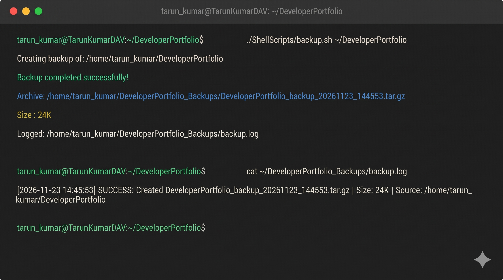

# DeveloperPortfolio — Capstone Project

**Student:** Tarun Kumar  
**Roll Number:** 2601730055  
**University:** K.R. Mangalam University, Gurugram  
**Batch:** 2026–2030 (B.Tech Computer Science and Engineering - AI & ML)  
**Specialisation Track:** Data Science & AI / ML  

---

## Live Links & Profiles
- **Live Portfolio Website:** [https://github.com/tarun4834/DeveloperPortfolio](https://github.com/tarun4834/DeveloperPortfolio)
- **GitHub Profile:** [https://github.com/tarun4834](https://github.com/tarun4834)
- **LinkedIn Profile:** [https://www.linkedin.com/in/tarun-kumar-40267228b/](https://www.linkedin.com/in/tarun-kumar-40267228b/)
- **Repository:** [https://github.com/tarun4834/DeveloperPortfolio](https://github.com/tarun4834/DeveloperPortfolio)

---

## Project Structure & Deliverables

### 1. Linux Systems & Hardware Diagnostics (`Linux/`)
- [system_profile.md](Linux/system_profile.md): Comprehensive system specification table (CPU, RAM, Storage, OS, Kernel) and binary number conversions (decimal 75 to binary, binary 110101 to decimal) with explanations.
- [commands_output.txt](Linux/commands_output.txt): Verified execution captures of `ls -la ~`, `ps aux | head -10`, `df -h`, and `free -h`.
- [collect_specs.sh](Linux/collect_specs.sh): Bash automation script to query CPU, memory, storage, and kernel metadata.
- [collect_commands.sh](Linux/collect_commands.sh): Automation script generating formatted terminal command diagnostics.

### 2. Shell Scripts & Automation (`ShellScripts/`)
- [sysinfo.sh](ShellScripts/sysinfo.sh): Automated system health reporting script featuring CPU load, memory utilization, and top 3 processes.
- [sysinfo_output.txt](ShellScripts/sysinfo_output.txt): Verified sample output generated by `sysinfo.sh`.
- [backup.sh](ShellScripts/backup.sh): Defensive folder archiving script with CLI input validation, tar compression, size tracking, and append-only logging to `~/DeveloperPortfolio_Backups/backup.log`.

### 3. REST API Integration & Pipelines (`API/`)
- [api_summary.md](API/api_summary.md): Technical overview of REST principles, HTTP status codes (`200 OK` vs `404 Not Found`), and `jq` data extraction filters.
- [fetch_api.py](API/fetch_api.py): Python script that queries the GitHub REST API and parses profile attributes (name, public repos, followers, created date).
- [github_profile.json](API/github_profile.json): Raw JSON payload fetched from `https://api.github.com/users/aj1000-g`.
- [sample_posts.json](API/sample_posts.json): Raw JSON array payload of 100 posts ingested from JSONPlaceholder.

### 4. Technical Resume & Roadmap (`Portfolio/`)
- [resume.pdf](Portfolio/resume.pdf): Professional one-page technical resume formatted with education, technical skills, capstone project highlights, and certifications.
- [learning_roadmap.md](Portfolio/learning_roadmap.md): Six-semester technical learning roadmap tailored for the Data Science & AI/ML specialisation track, with targets for DSA, systems programming, and NPTEL Python certification.

---

## Evidence & Verification Screenshots

### Automated Folder Backup Demo


### GitHub Profile & Pinned Repository


### LinkedIn Professional Profile


### GitHub Pages Portfolio Website


---

## Verification & Conventional Commits
All project commits adhere strictly to the Conventional Commits specification (`feat:`, `docs:`, `chore:`, `data:`). Execute the following command from the repository root to verify the commit history:
```bash
git log --oneline
```